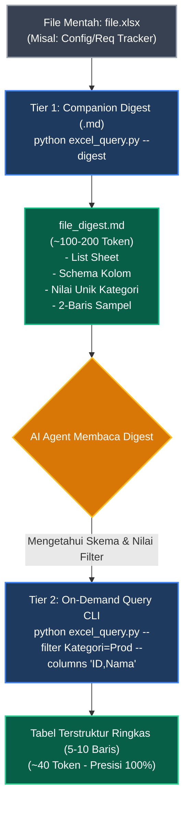
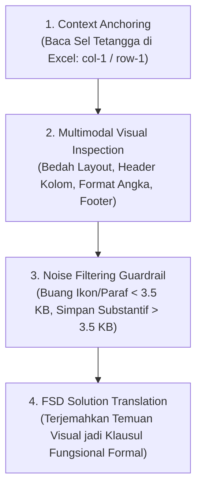

# 📊 SOP: Universal Excel (.xlsx) Inspector & Companion Digest Engine

Skill ini menyediakan metodologi standar untuk menangani dokumen spreadsheet Excel (`.xlsx`) seperti **Requirement Tracker**, **Configuration Matrix**, **Authorization Matrix**, dan **Data Migration Mapping** di dalam Universal Agentic Second Brain / RAG architecture.

---

## 💡 Filosofi & Masalah Utama: "Token Explosion Anti-Pattern"

> [!WARNING]
> **ANTI-PATTERN:** Mengonversi file Excel utuh (misal: 30 kolom x 500 baris) langsung menjadi tabel Markdown raksasa.
> - **Akibat:** Membakar puluhan ribu token context window sekaligus.
> - **Dampak Negatif:** AI mengalami *context dilution / attention drift*, data penting terlewat, dan biaya/latensi melonjak drastis.

### 🌟 Solusi: Pola Two-Tier Hybrid Architecture



1. **Tier 1 — Companion Digest (`<file>_digest.md`):**
   - Disimpan berdampingan dengan file `.xlsx`.
   - Hanya menghabiskan ~150 token.
   - Memuat: inventaris sheet, daftar nama kolom, jumlah baris, dan **kamus nilai kategori unik** (misal: Kategori apa saja yang ada, status apa saja yang ada).
   - Memberikan 100% gambaran menyeluruh tanpa memuat seluruh baris data.

2. **Tier 2 — Selective On-Demand Query (`excel_query.py`):**
   - Dijalankan via terminal Python bawaan (**0 dependensi pip, murni `zipfile` + `xml.etree`**).
   - Menarik hanya baris dan kolom yang spesifik ditanyakan oleh user/tugas.
   - Mengembalikan luaran terstruktur mini (hanya ~30–50 token).

---

## 🛠️ Panduan Perintah CLI (`excel_query.py`)

Lokasi Script:
`c:\D\FIleSharing\SAP\.agents\skills\excel-inspector\scripts\excel_query.py`

### 1. Membuat Companion Digest (`--digest`)
Buat ringkasan skema dan profil kolom:
```powershell
python "c:\D\FIleSharing\SAP\.agents\skills\excel-inspector\scripts\excel_query.py" --file "path\to\tracker.xlsx" --digest
```
*Output otomatis disimpan ke `path\to\tracker_digest.md`.*

---

### 2. Melihat Daftar Sheet (`--sheets`)
```powershell
python "c:\D\FIleSharing\SAP\.agents\skills\excel-inspector\scripts\excel_query.py" --file "path\to\tracker.xlsx" --sheets
```

---

### 3. Filter Spesifik & Proyeksi Kolom (`--query`)
Ambil data kategori tertentu, dan hanya kolom yang dibutuhkan:
```powershell
python "c:\D\FIleSharing\SAP\.agents\skills\excel-inspector\scripts\excel_query.py" `
  --file "path\to\tracker.xlsx" `
  --sheet "Sheet1" `
  --filter "Status=Active" `
  --columns "ID,Nama,Status,Deskripsi" `
  --format kv
```

#### Filter Operator:
- `=` : Pencocokan eksak (case-insensitive), misal `--filter "Status=Active"`
- `~` : Pencocokan substring (case-insensitive), misal `--filter "Kategori~Phase 1"`
- Filter Jamak: Dapat menggunakan beberapa flag `--filter` sekaligus, misal:
  `--filter "Status=Active" --filter "Tipe=Critical"`

---

### 4. Batasan & Format Output
- `--limit 10`: Batasi maksimal baris (default 20, isi `0` untuk semua).
- `--offset 10`: Pagination untuk data banyak.
- `--format kv`: (Rekomendasi Utama AI Reasoning) Format vertikal key-value bebas geser kolom.
- `--format json`: Menghasilkan struktur JSON untuk kebutuhan script/DDL.
- `--format markdown`: Menghasilkan tabel Markdown untuk preview visual manusia.
- `--preview 5`: Snapshot cepat 5 baris pertama dari sebuah sheet.

---

### 5. Ekstraksi Gambar & Diagram Tersemat (`--extract-images` / `-x`)
Mengekstrak seluruh screenshot, arsitektur, atau bukti UAT yang ditempel di lembar kerja Excel secara berurutan:
```powershell
# Ekstrak otomatis ke folder <file>_assets/
python "c:\D\FIleSharing\SAP\.agents\skills\excel-inspector\scripts\excel_query.py" `
  --file "path\to\tracker.xlsx" `
  --extract-images

# Atau jalankan script dedicated:
python "c:\D\FIleSharing\SAP\.agents\skills\excel-inspector\scripts\extract_excel_images.py" `
  --file "path\to\tracker.xlsx" `
  --output "path\to\custom_assets"
```
*Fitur ini 100% Zero-Dependency (Python Standard Library: zipfile + xml.etree.ElementTree), mengekstrak gambar terurut dari baris atas ke bawah.*

---

## 🧠 Algoritma 4-Langkah: Penafsiran Visual Gambar Tersemat di Excel (Floating Image Interpretation Engine)

Dalam proyek implementasi enterprise, pengguna dan konsultan sering menempelkan (*paste*) tangkapan layar secara acak/mengambang (*floating*) di atas lembar kerja Excel. AI Agent wajib menggunakan algoritma berpikir 4-langkah berikut untuk mengekstrak, membaca, dan menerjemahkannya ke dalam spesifikasi teknis:



### 1. Langkah 1: Context Anchoring (Membaca Sel di Sekitar Gambar)
Sebelum membuka file gambar fisik, agen wajib membaca teks sel di sebelah kiri atau di atas koordinat jangkar gambar (`row` dan `col` dari `twoCellAnchor`):
- **Contoh:** Jika gambar menempel di sel `B15`, baca teks pada sel `A15` atau header di baris `14`. Jika di `A15` tertulis *"Sampel PO dari Accurate (No. MIE26-0714)"*, jadikan teks ini sebagai **kunci konteks / caption awal**: gambar tersebut adalah cetakan baseline sistem lama klien yang harus dipelajari polanya.

### 2. Langkah 2: Multimodal Visual Inspection (Membaca Isi Visual Gambar)
Buka file gambar PNG hasil ekstraksi (`extract_excel_images.py`) menggunakan model visual multimodal dan bedah 4 elemen kritis:
- **Struktur Layout:** Apakah formulir berupa 1 halaman atau multi-halaman? Di mana letak logo korporat (kiri/kanan atas)? Apakah kotak alamat perusahaan memiliki bingkai merah atau style khusus?
- **Header & Kolom Tabel Item:** Apakah terdapat kolom *Item Code*, *Description*, *Litre/KG*, *Pack Price*, *Discount*, *Amount*? Catat nama teknis setiap kolom.
- **Format Angka & Mata Uang:** Apakah nominal angka (misal Rupiah IDR) menggunakan desimal (`0,00`) atau bilangan bulat? Apakah terdapat tanda tangan basah manual atau kotak otorisasi persetujuan elektronik (*Approval Matrix*)?
- **Footer & Logika Pajak:** Apakah formulir mencantumkan rincian PPN (VAT), PPh 22, bea meterai, atau teks terbilang (*Say: ... / Terbilang: ...*)?

### 3. Langkah 3: Filter Derau Visual (Noise Filtering Guardrail)
Pengguna sering menempelkan ikon kecil yang tidak substantif ke lembar kerja Excel (ikon centang hijau, tanda seru, bullet grafis, atau scan paraf).
- **Aturan Ambang Batas (Threshold Rule):**
  - Berkas gambar dengan ukuran **< 3.5 KB** diklasifikasikan sebagai **derau visual / dekoratif** dan wajib diabaikan.
  - Hanya berkas gambar **> 3.5 KB** yang terbukti berupa diagram substantif (mockup antarmuka pengguna, arsitektur integrasi, flowchart proses bisnis, atau tangkapan layar sistem SAP/Accurate) yang dipromosikan ke katalog aset.

### 4. Langkah 4: Penerjemahan Menjadi Butir Solusi FSD (Functional Solution Translation)
Temuan visual dari gambar yang ditempel asal-asalan tersebut wajib diterjemahkan secara presisi menjadi klausul desain fungsional formal di dalam dokumen FSD:
- **Kasus 1 (Kolom Kemasan):**  
  *Temuan Visual:* Pada screenshot formulir Accurate terlihat adanya kolom kemasan (*Pack Type / Drum / Pail*).  
  *Penerjemahan FSD (Bab 2):* *"Menambahkan integrasi tabel master `ZTV_MAT_PACK` untuk menarik rasio dan deskripsi kemasan per material (Keputusan K11 / Delta C11)."*
- **Kasus 2 (Teks Terbilang):**  
  *Temuan Visual:* Pada screenshot formulir terlihat adanya baris teks *"Terbilang: Dua Ratus Juta Rupiah"*.  
  *Penerjemahan FSD (Bab 2):* *"Mengintegrasikan komponen bersama Function Module `SPELL_AMOUNT` untuk konversi angka ke terbilang dwibahasa ID/EN (Delta C5)."*
- **Kasus 3 (Format Desimal):**  
  *Temuan Visual:* Pada sampel cetakan terlihat harga per pack memiliki anomali 4 angka desimal.  
  *Penerjemahan FSD (Bab 2):* *"Menerapkan logika normalisasi mata uang TCURX pada program pengemudi cetak agar nilai Rupiah selalu bulat tanpa desimal (Delta C12)."*


---

## 📋 SOP Eksekusi bagi AI Agent

Saat user mengajukan pertanyaan seputar data Excel (misal: *"Tampilkan daftar item aktif yang masuk prioritas tinggi"*):

1. **Cek Digest Terlebih Dahulu:**
   - Cek apakah file `<nama_file>_digest.md` sudah ada di folder terkait.
   - Jika belum ada, jalankan `--digest` terlebih dahulu via `excel_query.py`.
   - Baca file digest menggunakan `view_file` untuk memahami nama sheet, nama kolom, dan nilai kategorinya.

2. **Jalankan Query Selektif:**
   - Gunakan nama kolom yang tepat dari digest untuk menyusun perintah `python excel_query.py --filter ... --columns ... --format kv`.
   - Ambil hanya kolom yang relevan dengan pertanyaan user.

3. **Sajikan Hasil ke User:**
   - Sajikan tabel/ringkasan hasil eksekusi query.
   - Jelaskan insight-nya tanpa membebani context window dengan data kolom yang tidak relevan.

