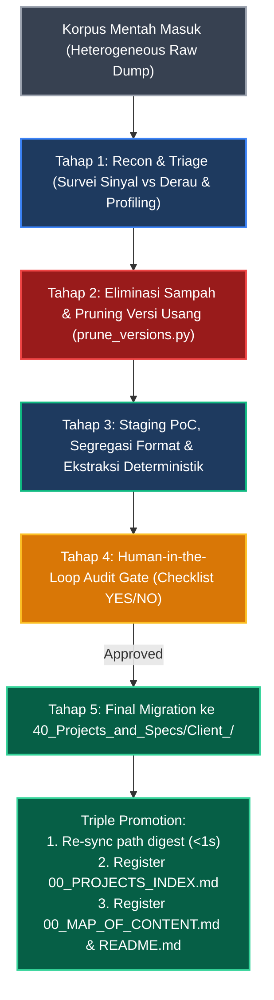

# 🚀 SOP: Enterprise Knowledge Project Onboarding (Sandbox Staging & PoC)

> [!IMPORTANT]
> **[MASTER ARCHITECTURAL BLUEPRINT REFERENCE]**  
> Skill ini merupakan implementasi operasional dari cetak biru sistem [[KNOWLEDGE_BASE_ARCHITECTURE.md]] (Section 3: *Heterogeneous Raw Corpus Triage & Onboarding Protocol*).  
> Seluruh alur penataan direktori, isolasi format, pemangkasan versi redundan ($V_N$ & $V_{N-1}$), penyusunan kamus istilah tata kelola, supresi derau visual, injeksi metadata digest, serta gerbang audit deployment tunduk secara ketat pada direktif arsitektur tersebut.

Skill ini mengatur alur kerja **Standard Operating Procedure (SOP)** saat menerima **korpus dokumen mentah baru** (arsip dump zip, repositori clone Git klien, atau korpus dokumen heterogen tanpa struktur).

Metodologi yang digunakan adalah **"Staging PoC First"** — seluruh pembersihan, eliminasi derau, dan penataan dilakukan **di dalam folder mentah terlebih dahulu (sandbox)** sebelum dipindahkan ke master repositori.

---

## 🛑 ATURAN EMAS: JANGAN SENTUH MASTER SEBELUM POC SELESAI!

> [!CAUTION]
> **[MANDATORY CONSTRAINT / SANDBOX ISOLATION DIRECTIVE]**  
> **DILARANG KERAS** langsung memindahkan atau mencampur folder mentah ke dalam master `40_Projects_and_Specs/`!  
> Folder mentah wajib melewati tahap **Staging PoC (Pembersihan di tempat)** terlebih dahulu agar artefak sampah tidak mengotori master architecture.

---

## 📋 Alur 5 Tahap Staging & Migrasi Proyek



---

### Tahap 1: Recon & Triage (Survei Konten & Profiling)
Sebelum mengubah apa pun, lakukan audit inventarisasi:
1. **Deteksi Ekstensi & Ukuran:** Petakan file `.docx`, `.xlsx`, `.pptx`, `.pdf`, `.md`, `.png`.
2. **Audit Integritas Ekstensi Biner (Zero-Dependency Schema Inspection):**
   * Jalankan `validate_extensions.py` untuk mendeteksi file salah ekstensi (misal file spreadsheet `.xlsx` yang keliru dinamai `.docx`, atau file korup/legacy).
   * Script memeriksa magic bytes `PK\x03\x04` dan skema otoritatif MIME type di `[Content_Types].xml` (`wordprocessingml` vs `spreadsheetml`) dalam < 2 ms per file (0 LLM Token).
   ```powershell
   # Audit deteksi salah ekstensi (Dry Run)
   python "c:\D\FIleSharing\SAP\.agents\skills\knowledge-project-onboarding\scripts\validate_extensions.py" --dir "path\to\folder-mentah"

   # Eksekusi perbaikan/rename otomatis
   python "c:\D\FIleSharing\SAP\.agents\skills\knowledge-project-onboarding\scripts\validate_extensions.py" --dir "path\to\folder-mentah" --apply
   ```
3. **Pisahkan Sinyal Teknis vs Derau Manajerial:**
   * 🟢 **Technical Signal (Prioritas):** Spesifikasi fungsional/teknis (FS/TS), Tracker Konfigurasi, Skema Database DDL, Screen Mockup.
   * 🔴 **Managerial Noise (Sekunder):** Slide presentasi SteerCo (`.pptx`), kurva S-Curve, Change Management OCM, draft notulen rapat mingguan.
4. **Audit Versi Dokumen (Multi-Versioning Detection):**
   * Pindai dokumen berulang dengan akhiran versi (misal: `_v0.1`, `_v0.2`, ..., `_v0.5`).
5. **Buat Profil Awal di `CLIENT_CONTEXT.md`:**
   * Dokumentasikan nama klien/inisiatif, versi arsitektur target, cakupan modul/layanan, dan inventaris awal berkas.

---

### Tahap 2: Eliminasi Artefak Sampah & Pruning Versi Usang

Di dalam folder mentah, lakukan pembersihan bertahap:
1. **Hapus Folder Sampah Non-Relevan:**
   - ❌ Hapus folder `.git/` dan `.gitignore` lama (mencegah nested git repo).
   - ❌ Hapus folder temporary/export (misal: output generator LLM lama, `archive/` draft kadaluwarsa).

2. **Aturan Emas Retensi Versi Dokumen (Maksimal 2 Versi Terakhir):**
   > [!IMPORTANT]
   > **Golden Rule Retensi Versi ($V_N$ & $V_{N-1}$):**
   > Jika ditemukan serangkaian revisi file (misal: `v0.1`, `v0.2`, `v0.3`, `v0.4`, `v0.5`), **HANYA SIMPAN 2 VERSI TERAKHIR**:
   > - **Versi $V_N$ (Terbaru):** Menjadi *Active Primary Specification*.
   > - **Versi $V_{N-1}$ (Satu tingkat sebelumnya):** Menjadi *Comparison Baseline / Fallback Reference*.
   > - **Versi Usang ($< V_{N-1}$):** **Wajib Dihapus (Purged)**!
   > 
   > **Alasan Krusial:**
   > - 🚫 **Anti-Confusion bagi AI:** AI Agent tidak akan bingung atau berhalusinasi mengutip klausul lama yang sebenarnya sudah dibatalkan/direvisi klien.
   > - 💾 **Hemat Storage & Token:** Mengurangi beban MB disk dan mencegah duplikasi hasil pencarian RAG.

   **Eksekusi Otomatis via Engine Pruning:**
   ```powershell
   # Simulasi cek (Dry Run)
   python "c:\D\FIleSharing\SAP\.agents\skills\knowledge-project-onboarding\scripts\prune_versions.py" --dir "path\to\folder-mentah" --keep 2

   # Eksekusi penghapusan versi usang (< N-1)
   python "c:\D\FIleSharing\SAP\.agents\skills\knowledge-project-onboarding\scripts\prune_versions.py" --dir "path\to\folder-mentah" --keep 2 --apply
   ```

---

### Tahap 3: Staging PoC Internal, Segregasi Format & Ekstraksi Deterministik

Tanpa memindahkan folder keluar, tata isi folder mentah menjadi **kamar standar terisolasi**:

```text
📁 <folder-mentah-staging>/
├── 📄 CLIENT_CONTEXT.md             <-- Rangkuman inisiatif, versi sistem, daftar spesifikasi aktif, & Kamus PMO
│
├── 📁 Specs_FS_TS/                  <-- [KHUSUS TEKNIS] Dokumen FS, TS, DDL, & Mockup
│   ├── 📄 README.md                 <-- Index petunjuk navigasi folder spesifikasi
│   │
│   ├── 📁 Docx_Specs/               <-- [Format Word] Seluruh FS/TS .docx, digest, & assets
│   │   ├── 📄 00_DOCX_INVENTORY.md  <-- Master katalog seluruh dokumen Word
│   │   ├── fs_procurement_form.docx
│   │   ├── fs_procurement_form_digest.md  <-- Digest bersanding dengan file tuannya [CO-LOCATED]
│   │   └── 📁 fs_procurement_form_assets/ <-- Diagram & mockup terekstrak lokal [CO-LOCATED]
│   │
│   ├── 📁 Excel_Trackers/           <-- [Format Excel] Seluruh spreadsheet .xlsx & digest
│   │   ├── 📄 00_XLSX_INVENTORY.md  <-- Master katalog seluruh spreadsheet Excel
│   │   ├── config_matrix_tracker.xlsx
│   │   └── config_matrix_tracker_digest.md <-- Digest bersanding dengan file tuannya [CO-LOCATED]
│   │
│   ├── 📁 Markdown_Specs/           <-- [Format Asli MD] Dokumen yang aslinya memang .md
│   │   ├── interface_definition.md
│   │   └── table_schema.md
│   │
│   └── 📁 screen_captures/          <-- Tangkapan layar layout sistem / wireframe
│
├── 📁 <Platform>_Source_Code/       <-- [KODE SISTEM MURNI] Driver, Class OO, Test Runner (TR-ready)
│   └── 📄 00_INDEX.md               <-- Katalog & matriks RICEF kode sistem klien
│
├── 📁 Document_Tooling/             <-- [PERKAKAS DOKUMEN] Skrip Python builder/TOC/ekstraktor FSD
│   └── 📄 00_INDEX.md               <-- Katalog utilitas otomasi dokumen & cara pakai
│
├── 📁 Governance_and_PMO/           <-- [DOKUMEN MANAJERIAL] Terisolasi agar tidak membakar token
│   ├── project_charter.docx
│   ├── data_migration_scope.docx
│   ├── 📁 mom_and_weekly_reviews/
│   └── 📁 presentations_steerco/
│
└── 📁 Outputs_and_Logs/             <-- Log uji, CSV hasil query, & text extracts
```

#### Aturan Format Segregation, Digest Co-location & PMO Glossary:
1. **Pemisahan Folder Format Dokumen:** File `.docx`, `.xlsx`, dan native `.md` dikelompokkan ke dalam kamar masing-masing (`Docx_Specs/`, `Excel_Trackers/`, `Markdown_Specs/`).
2. **Digest Co-location (Bersanding dengan Tuan):** File companion digest (`<file>_digest.md`) dan folder diagram (`<file>_assets/`) **wajib bersanding di folder yang sama dengan file tuannya**, membentuk satu paket mandiri (*self-contained package*).
3. **Standar Penamaan:** File teknis wajib di-rename ke **`lower_snake_case`** ringkas tanpa karakter rawan (kurung `()`, spasi ganda, koma).
4. **Penyusunan Kamus Istilah PMO & Tata Kelola Enterprise:**
   - Dokumen manajerial di folder `Governance_and_PMO/` (seperti *Project Charter*, *Steering Committee*, *MoM*, *S-Curve*, *Fit-to-Standard*, *OCM*, *SoD*, *SIT/UAT*, *Cutover*, *Hypercare*) memuat istilah manajerial yang sering membingungkan developer teknis.
   - **Wajib Ekstraksi Glosarium:** Di dalam berkas `CLIENT_CONTEXT.md`, wajib disusun bab khusus `## 6. Kamus Istilah PMO, Tata Kelola & Proyek Enterprise untuk Developer` yang mendefinisikan istilah manajerial tersebut beserta arti konkretnya bagi developer, agar tim rekayasa dan agen AI memahami hierarki pelaporan, batasan ruang lingkup (*In-Scope vs Out-of-Scope*), dan siklus pengujian sejak hari pertama.
5. **Segregasi Tegas Kode Platform vs Perkakas Otomasi Dokumen (Anti-Taxonomy Bug):**
   - **DILARANG KERAS** mencampur skrip Python utilitas generator/perakit dokumen FSD (`.py`, builder, TOC resolver, ekstraktor gambar) ke dalam folder kode runtime sistem (misal `ABAP_Source_Code/`).
   - Skrip generator dokumen adalah **Document Tooling lokal**, bukan artefak runtime ERP/sistem klien.
   - Wajib dipisahkan ke `Document_Tooling/` lengkap dengan `00_INDEX.md`, sementara `<Platform>_Source_Code/` hanya berisi kode murni platform sistem klien.

#### Aturan Supresi Derau Visual & Injeksi Caption Metadata:
6. **Deterministic Asset Filtering (Noise Suppression):**
   - **Discard / Ignore:** Logo perusahaan/kop surat, scan tanda tangan/paraf pejabat, stempel basah, icon kecil atau garis pemisah (< 3.5 KB).
   - **Persist ke `<file>_assets/`:** Flowchart proses bisnis, diagram arsitektur sistem, skema ERD/UML, screenshot tampilan antarmuka / wireframe form.
7. **Injeksi Metadata Gambar & Protokol Dual-Track AI:**
   - Teks caption, judul bagan, atau paragraf penjelas di sekitar gambar wajib disedot dan di-inject ke kolom *Caption / Context Description* pada tabel katalog digest.
   - **Model Text-Only (DeepSeek V4 Pro API):** Cukup membaca metadata teks pada file digest tanpa membuka file fisik gambar.
   - **Model Multimodal Vision (Gemini / Claude / GPT):** Wajib mengevaluasi teks metadata terlebih dahulu untuk memahami intensi diagram, kemudian membuka gambar fisik di `<file>_assets/` untuk verifikasi visual detail.

#### Eksekusi Batch Inspector Lokal (0 LLM Token):
Jalankan batch inspector untuk menghasilkan companion digest dan mengatalogkan tabel & diagram:
```powershell
# 1. Batch inspect seluruh dokumen Word (.docx) & ekstrak diagram substantif ke disk:
python "c:\D\FIleSharing\SAP\.agents\skills\docx-inspector\scripts\docx_inspector.py" `
  --dir "path\to\Specs_FS_TS\Docx_Specs"

# 2. Batch inspect seluruh spreadsheet Excel (.xlsx):
python "c:\D\FIleSharing\SAP\.agents\skills\excel-inspector\scripts\excel_query.py" `
  --dir "path\to\Specs_FS_TS\Excel_Trackers"
```
*Eksekusi berjalan 100% lokal di CPU (<1 detik), menghasilkan `00_DOCX_INVENTORY.md` dan `00_XLSX_INVENTORY.md` tanpa memakan kuota token API.*

---

### Tahap 4: Human-in-the-Loop Audit Gate (Review Pengembang / User)

Sebelum memindahkan folder keluar dari staging, agen AI **DILARANG** melakukan migrasi sepihak. Agen AI wajib menampilkan **Checklist Audit Kesiapan Deployment (YES/NO)** kepada pengguna:

```text
=======================================================
📋 AUDIT KESIAPAN DEPLOYMENT (STAGING -> MASTER)
=======================================================
1. Profiling CLIENT_CONTEXT.md & Kamus PMO Lengkap?          [YES / NO]
2. Integritas Ekstensi Biner Tervalidasi (validate_ext)?      [YES / NO]
3. Pembersihan .git, temp, & Pruning Versi (<VN-1)?           [YES / NO]
4. Segregasi Format (Docx / Excel / Markdown) Rapi?           [YES / NO]
5. Co-location Companion Digest & Folder Aset Sesuai?         [YES / NO]
6. Derau Visual Disupresi & Metadata Caption Di-inject?       [YES / NO]
7. Segregasi Kode Platform vs Document_Tooling Terpisah?      [YES / NO]
8. Batch Inspector Inventaris Berhasil (0 Token)?             [YES / NO]
=======================================================
Rekomendasi Deployment: [YES / NO]
Menunggu persetujuan eksplisit pengguna manusia: "Approved"
=======================================================
```
*Agen AI wajib menunggu konfirmasi eksplisit dari user sebelum melanjutkan ke Tahap 5.*

---

### Tahap 5: Final Migration & Triple Master Registry Promotion

Setelah izin deployment disetujui pengguna secara eksplisit:
1. **Remapping Fisik:**
   Pindahkan / rename folder staging ke direktori produksi resmi:  
   `c:\D\FIleSharing\SAP\40_Projects_and_Specs\Client_<NamaKlien>/`
2. **Path Re-synchronization (<1 Detik, 0 Token):**
   Jalankan ulang batch inspector satu baris pada path tujuan baru untuk memperbarui path absolut perintah CLI siap-pakai di dalam seluruh file digest:
   ```powershell
   python "c:\D\FIleSharing\SAP\.agents\skills\docx-inspector\scripts\docx_inspector.py" --dir "c:\D\FIleSharing\SAP\40_Projects_and_Specs\Client_<NamaKlien>\Specs_FS_TS\Docx_Specs"
   python "c:\D\FIleSharing\SAP\.agents\skills\excel-inspector\scripts\excel_query.py" --dir "c:\D\FIleSharing\SAP\40_Projects_and_Specs\Client_<NamaKlien>\Specs_FS_TS\Excel_Trackers"
   ```
3. **Pendaftaran Tiga Titik (*Triple Master Registry Promotion*):**
   * **Titik 1: Master Projects Index:** Buka [[40_Projects_and_Specs/00_PROJECTS_INDEX.md]], tambahkan baris entri klien baru pada tabel:
     ```markdown
     | **[Nama Klien]** | [Modul Terkait] ([Deskripsi Singkat]) | [[40_Projects_and_Specs/Client_<NamaKlien>/CLIENT_CONTEXT.md]] | 🟢 **Aktif** |
     ```
   * **Titik 2: Second Brain Map of Content:** Buka [[00_MAP_OF_CONTENT.md]], tambahkan tautan portofolio di Bagian 4 (Proyek Aktif).
   * **Titik 3: Root Documentation:** Buka [[README.md]], pastikan pohon direktori mencerminkan folder klien baru.

---

## 🎯 Jaminan Rekayasa Pendekatan Ini
1. **Master Selalu Bersih:** Arsitektur utama tidak pernah terancam oleh file sampah atau duplikasi dokumen usang.
2. **Zero Context Window Explosion:** Seluruh dokumen manajerial dan biner terisolasi; digest dan CLI retrieval menjaga konsumsi token tetap di angka minimal (~150-300 token).
3. **Zero Tool Drift & Zero Hallucination:** Pemisahan folder format dokumen meniadakan kebingungan pemilihan perkakas pada model bahasa, dan aturan retensi versi ($V_N$ & $V_{N-1}$) mencegah rujukan ke spesifikasi kadaluwarsa.
4. **Provable & Traceable:** Checkpoint audit manusia dan registrasi tiga titik menjamin integritas repositori enterprise tetap terjaga utuh.

