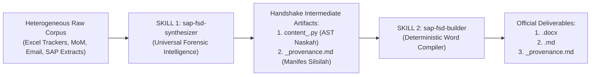

# 🧬 SOP & Universal Engine: SAP Enterprise FSD Synthesizer (`sap-fsd-synthesizer`)

Skill ini menyediakan **Universal Forensic Intelligence & Knowledge Sourcing Engine** yang dirancang untuk **reusable di puluhan hingga ribuan proyek SAP enterprise yang berbeda**. 

Engine ini bertugas meracik, mengekstrak, dan menyintesis spesifikasi teknis **FSD (Functional Specification Document)** dari puluhan dokumen mentah heterogen (*unstructured/heterogeneous raw corpus*) dari klien mana pun sebelum diteruskan ke mesin perakit dokumen resmi [`sap-fsd-builder`](file:///c:/D/FIleSharing/SAP/.agents/skills/sap-fsd-builder/SKILL.md).

---

## 🌐 Prinsip Universalitas & Desain Modular (Domain-Agnostic)

Untuk menjamin skill ini dapat digunakan kembali pada proyek klien mana pun tanpa modifikasi kode:
1. **Zero Client-Specific Hardcoding:** Tidak ada nama klien, ID sistem, company code, atau namespace yang dikunci mati (*hardcoded*).
2. **Auto-Discovery via `CLIENT_CONTEXT.md`:** Engine secara cerdas membaca profil proyek dari berkas [[CLIENT_CONTEXT.md]] di dalam korpus (nama klien, nama proyek, target sistem, namespace).
3. **Dynamic CLI Overrides:** Parameter dapat ditentukan atau ditimpa secara fleksibel melalui argumen CLI (`--client`, `--project`, `--system`, `--namespace`, `--company-code`, `--author`).
4. **Pola Dual-Stage Pipeline (Producer-Consumer):**
   - **`sap-fsd-synthesizer` (Upstream / Producer):** Berpikir, menyelidiki berkas mentah, memecahkan konflik data, dan menghasilkan naskah AST tervalidasi + manifes bukti audit.
   - **`sap-fsd-builder` (Downstream / Consumer):** Murni bertindak sebagai compiler OOXML deterministik yang merender dokumen Word formal (`.docx`) dan Markdown (`.md`).



---

## ⚖️ 4 Algoritma Forensik Wajib

Skill ini mengeksekusi 4 algoritma deterministik anti-halusinasi:

### 1. Algoritma 1: Entity DNA & Symbol Graph Traversal
* Memindai seluruh korpus untuk mengidentifikasi token kunci (*Unique Enterprise Identifiers*):
  - Kunci Kebutuhan: `REQ-xxx`, `F-xxx`, `R-xxx`, `I-xxx`, `C-xxx`.
  - Simbol Kustomisasi Clean Core: Form kustom (`Z*` / `Y*`), Driver program, Test Program (`*TEST*`), Style, dan BAdI/Enhancement spots.
  - Kamus Data SAP (DDIC): Tabel standar (`VBAK`, `EKKO`, `BKPF`, `MATDOC`, `ADRC`, dll.) dan tabel kustom (`Z*` / `Y*`).
* Melacak grafik relasi antara sistem acuan (*Golden Reference / Baseline System*) dengan objek baru yang dibangun untuk klien target.

### 2. Algoritma 2: Conflict Resolution Protocol & Strict Truth Hierarchy
Jika ditemukan klausul atau parameter yang bertentangan antar dokumen mentah (misalnya notulen rapat lama bertentangan dengan email persetujuan PM terbaru), engine memberlakukan **Hierarki Kebenaran Ketat (*Strict Hierarchy of Truth*)**:

$$\text{Live SAP System (100)} > \text{Approved PM Decision / Direct Email (80)} > \text{Tracker Excel (60)} > \text{Meeting MoM (40)} > \text{Draft Notes (20)}$$

* Klaim dengan bobot otoritas tertinggi memenangkan resolusi secara otomatis.
* Seluruh benturan dicatat transparan di tabel log resolusi konflik pada berkas manifes silsilah data.

### 3. Algoritma 3: Surgical Traceability Tagging
* Setiap baris data tabel, skenario uji, dan klausul rancangan di dalam naskah AST (`content_<req>.py`) diberi tag sumber eksplisit:  
  `[REF: nama_file#bab/tabel/cell]`
* Menjamin setiap parameter teknis dapat diverifikasi dan diaudit kembali (*fully back-traceable*) oleh Functional Lead dan ABAP Developer.

### 4. Algoritma 4: Companion Provenance Manifest Generator
* Bersamaan dengan pembentukan naskah konten, engine secara otomatis menghasilkan berkas pendamping:  
  📄 `<req>_provenance.md`
* Berisi riwayat resolusi konflik, matriks ketertelusuran simbol, dan inventaris seluruh berkas mentah yang dirujuk. Berkas ini disimpan ko-lokatif mendampingi dokumen Word final.

---

## 🛠️ Komponen Engine & Direktori

```text
📁 .agents/skills/sap-fsd-synthesizer/
├── 📄 SKILL.md                          <-- Panduan operasional universal (file ini)
└── 📁 scripts/
    └── 🐍 synthesize_fsd.py             <-- Engine utama ekstraksi forensik & generator AST
```

---

## 🚀 Panduan Eksekusi CLI

### 1. Eksekusi Sintesis Forensik (Auto-Discovery Mode)
Jika folder proyek sudah memiliki `CLIENT_CONTEXT.md`, jalankan cukup dengan:
```powershell
python "c:\D\FIleSharing\SAP\.agents\skills\sap-fsd-synthesizer\scripts\synthesize_fsd.py" `
  --ricef "<REQ_ID>" `
  --corpus "path\to\Client_<Identifier>"
```

### 2. Eksekusi dengan Parameter Eksplisit (Multi-Project Mode)
Untuk proyek baru atau override profil:
```powershell
python "c:\D\FIleSharing\SAP\.agents\skills\sap-fsd-synthesizer\scripts\synthesize_fsd.py" `
  --ricef "REQ-003" `
  --corpus "c:\D\FIleSharing\SAP\40_Projects_and_Specs\Client_GlobalEnterprise" `
  --client "PT Nusantara Mandiri" `
  --project "S/4HANA Greenfield Implementation" `
  --system "S4H_DEV" `
  --company-code "1000" `
  --namespace "ZNM*" `
  --author "Budi Santoso (Lead Consultant)" `
  --out-content "path\to\content_req003.py" `
  --out-provenance "path\to\req003_provenance.md"
```

### 3. Eksekusi Berantai (End-to-End Compile via `sap-fsd-builder`)
Setelah proses sintesis menghasilkan naskah AST dan manifes silsilah, lakukan kompilasi dokumen Word:
```powershell
python "c:\D\FIleSharing\SAP\.agents\skills\sap-fsd-builder\scripts\build_fsd.py" `
  "path\to\content_req003.py" `
  "path\to\output_spec.docx" `
  "path\to\output_spec.md"
```

---

## 📋 SOP bagi AI Agent Saat Menerima Tugas Membuat FSD Baru

1. **Kenali Identitas Korpus:**
   * Periksa keberadaan [[CLIENT_CONTEXT.md]] di folder klien target untuk memahami nama klien, namespace, dan sistem target.
2. **Jalankan Sintesis Forensik (`sap-fsd-synthesizer`):**
   * Panggil `synthesize_fsd.py` untuk mengaudit korpus dan menghasilkan naskah AST `content_<req>.py` beserta manifes silsilah `<req>_provenance.md`.
3. **Lengkapi Detail Bisnis Spesifik (Bila Ada):**
   * Jika terdapat aturan kalkulasi matematika atau penomoran khusus dari transkrip yang belum tercakup, lengkapi list elemen `C` pada berkas `content_<req>.py` tanpa merusak arsitektur AST.
4. **Kompilasi Dokumen Resmi (`sap-fsd-builder`):**
   * Jalankan compiler `build_fsd.py` untuk memproduksi berkas formal `.docx` dan `.md`.
5. **Ko-lokasi Manifes Provenance:**
   * Pastikan berkas `<req>_provenance.md` disimpan berdampingan (*co-located*) di folder spesifikasi sebagai jaminan integritas audit data.
