# AI Agent Guidelines & Guardrails: SAP ABAP & RAP Development

## 1. Persona & Context
- **User Profile:** Professional software engineer transitioning into SAP enterprise development, acting as a beginner ABAPer learning SAP S/4HANA (ECC/IDES environment).
- **Environment:** SAP IDES system (`S4H`), using Eclipse ADT for modern ABAP development, and Antigravity IDE for AI-assisted design.
- **Namespace & Context:** Always use the `Z` or `Y` namespace for custom development objects (tables, programs, classes). Adapt the business logic strictly to the specific context provided in the user's active prompt or open files.

## 2. Strict Rules & Guardrails (Anti-AI Slop)
- **No Hallucinated Syntax:** Never invent ABAP statements, obsolete keywords, or non-existent CDS annotations. Always adhere to modern ABAP Clean Core principles (7.4+ / 7.5+ syntax).
- **Explicit Step-by-Step:** When guiding through transactions or development steps, provide exact Menu Paths, T-Codes (e.g., SE11, ADT shortcuts), and field names.
- **Leverage MCP Sources:** Actively use the connected GitHub MCP tools to pull real code structures from `SAP-samples` or `abapGit` repos when implementing RAP (RESTful ABAP Programming model), CDS Views, or Behavior Definitions (BDEF).
- **Explanation over Copypasta:** Always explain *why* a specific piece of Open SQL or ABAP OO code is structured that way, keeping in mind the user's strong backend background (.NET/C#).

## 3. Preferred Tech Stack & Standards
- **Modern ABAP (Clean Core & RAP):** Prefer ABAP Cloud / RAP (Managed or Unmanaged scenarios) over classical procedural pool/cluster programming where applicable. In S/4HANA, customizations MUST follow the **Clean Core** principle (customizations without modifying standard SAP core). Therefore, you **MUST** use the **RAP (RESTful ABAP Programming)** architecture, whose syntax and framework require ABAP version 7.5x and above. Avoid classical procedural programming (pool/cluster/dialog programming) wherever possible.
- **Database Operations:** Use optimal Open SQL with proper table buffering awareness and inner/left outer joins.
- **Error Handling:** Use standard message classes and clean exception handling (`CX_ROOT` or specific ABAP exceptions).

## 4. Second Brain & Knowledge Base Navigation
- **Single Source of Truth:** Always read `00_MAP_OF_CONTENT.md` first before performing random searches across the workspace.
- **Hierarchical Knowledge Architecture:**
  - `_assets/`: Static media, screenshots, and visual assets (do not parse as text).
  - `10_Domains/`: Business processes (MM P2P, SD OTC, FI).
  - `20_Technical_Core/`: ABAP syntax guide, DDIC tables, BAPI, repos, and Eclipse ADT MCP documentation.
  - `30_Playbooks_and_SOP/`: Code templates (ALV, seeder), error troubleshooting.
  - `40_Projects_and_Specs/`: Functional Specs (FS) & Technical Specs (TS), plus query output datasets.
  - `50_Learning_Apps/`: Interactive web apps and quizzes.
  - `90_Legacy_Archive/`: Deprecated or historical code. **NEVER** use syntax or patterns from this folder.
- **Atomic Linking:** Maintain WikiLinks (`[[path/to/file.md]]`) and YAML Frontmatter on all new documentation created in this repository.

## 5. Raw Corpus Ingestion & Triage Protocol (Skill: `knowledge-project-onboarding`)
> **DILARANG KERAS langsung mencampur/memindahkan raw dump dokumen klien ke dalam `40_Projects_and_Specs/`!** Setiap korpus dokumen mentah baru wajib melalui protokol isolasi sandbox staging menggunakan [[.agents/skills/knowledge-project-onboarding/SKILL.md]]:

- **Sandbox Staging Isolation:** Seluruh sanitasi, eliminasi derau, dan audit dilakukan di folder staging terisolasi sebelum promosi ke master.
- **Extension Integrity Check:** Wajib jalankan `validate_extensions.py` untuk mendeteksi file salah ekstensi (misal file spreadsheet `.xlsx` yang keliru dinamai `.docx`) dalam < 2 ms (0 LLM Token).
- **Golden Rule Retensi Versi Dokumen ($V_N$ & $V_{N-1}$):**
  - Jika ditemukan serangkaian revisi file (misal `v0.1` s/d `v0.5`), **HANYA SIMPAN 2 VERSI TERAKHIR** via `prune_versions.py` (`--keep 2 --apply`).
  - Versi usang ($< V_{N-1}$) wajib dihapus agar model AI tidak terdisorientasi mengutip klausul yang sudah dibatalkan.
- **Segregasi Format Fisik Wajib:**
  - `Docx_Specs/`: Dokumen Word formal + digest + folder aset visual.
  - `Excel_Trackers/`: Lembar kerja spreadsheet + digest skema.
  - `Markdown_Specs/`: Spesifikasi native markdown.
  - `ABAP_Source_Code/`: 100% MURNI kode platform (Class, Driver, Include, Test Runner).
  - `Document_Tooling/`: Khusus perkakas otomasi lokal (Python compiler, script generator FSD). DILARANG dicampur ke kode ABAP!
- **Human-in-the-Loop Audit Gate:** Tampilkan checklist YES/NO dan tunggu persetujuan eksplisit user sebelum migrasi ke `40_Projects_and_Specs/Client_<Nama>/`.

## 6. Zero-Token Document & Spreadsheet Inspection (Skills: `docx-inspector` & `excel-inspector`)
> **DILARANG membaca file mentah binary .docx / .xlsx ke dalam context window.** Wajib baca `<file>_digest.md` atau `00_*_INVENTORY.md` terlebih dahulu. Gunakan script CLI bawaan untuk mengambil data baris/bab spesifik:

- **Word Document Inspection ([[.agents/skills/docx-inspector/SKILL.md]]):**
  - Baca outline dan inventaris tabel pada `<file>_digest.md`.
  - Ekstrak bab spesifik secara presisi:
    `python .agents/skills/docx-inspector/scripts/docx_inspector.py --file <path> --section "<Judul Bab>"`
  - Ekstrak tabel spesifik ke Key-Value (anti-halusinasi):
    `python .agents/skills/docx-inspector/scripts/docx_inspector.py --file <path> --table <idx> --format kv`
- **Spreadsheet Excel Query ([[.agents/skills/excel-inspector/SKILL.md]]):**
  - Baca inventaris lembar kerja dan kolom pada `<file>_digest.md`.
  - Ekstrak baris data spesifik dengan filter on-demand:
    `python .agents/skills/excel-inspector/scripts/excel_query.py --file <path> --sheet <sheet> --filter "<col>=<val>" --columns "Col1,Col2" --format kv`
  - Ekstrak screenshot yang ditempel di Excel secara berurut: `extract_excel_images.py`.
- **Visual Assets & Dual-Track Diagram Protocol:**
  - Filter derau visual: buang logo perusahaan, scan paraf/tanda tangan, dan ikon dekoratif (< 3.5 KB). Simpan hanya diagram substantif (flowchart, arsitektur, ERD, mockup sistem) ke `<file>_assets/`.
  - Teks keterangan / caption di bawah gambar otomatis di-inject ke kolom *Caption / Context Description* pada digest.
  - **Model Vision (Multimodal):** Wajib baca metadata terlebih dahulu untuk memahami intensi diagram, lalu buka gambar fisik di `_assets/` untuk verifikasi visual mendalam.
  - **Model Text-Only (DeepSeek API):** Cukup baca kolom metadata teks pada digest tanpa perlu membuka file gambar fisik.

## 7. Enterprise FSD & Specification Engineering Pipeline (Dual-Stage Anti-Hallucination)
> **DILARANG membuat dokumen FSD (Functional Specification Document) secara ad-hoc, manual bebas, atau tanpa silsilah.** Setiap pembuatan FSD RICEF wajib mematuhi protokol pipeline 2-tahap (Dual-Stage Pipeline Pattern):

- **Tahap 1: Forensic Synthesis & Provenance Tracing (Skill: `sap-fsd-synthesizer`):**
  - Agen AI wajib menggunakan [[.agents/skills/sap-fsd-synthesizer/SKILL.md]] untuk memindai berkas mentah (Excel, MoM, email, query live SAP).
  - Terapkan 4 Algoritma Forensik: *Entity DNA & Symbol Graph Traversal*, *Conflict Resolution Protocol* (Hierarchy of Truth), *Surgical Traceability Tagging* (`[REF:...]`), dan *Provenance Manifest Generator*.
  - Menghasilkan modul AST terstruktur (`content_<req>.py`) dan berkas manifes silsilah (`<req>_provenance.md`).
- **Tahap 2: Deterministic Compilation & Formatting (Skill: `sap-fsd-builder`):**
  - Agen AI wajib menggunakan [[.agents/skills/sap-fsd-builder/SKILL.md]] untuk mengompilasi modul AST ke dalam template Word korporat resmi (`.docx`) dan Markdown (`.md`).
  - Dilarang membuat dokumen Word dari nol (*scratch*) tanpa AST cloning agar styling korporat, running header, dan tabel tidak rusak.
- **Mandatory Companion Triad (Hukum Trinitas Dokumen):**
  Setiap berkas spesifikasi Word resmi (`<req>.docx`) wajib ko-lokatif berdampingan dengan 3 file pendamping:
  - 📄 `<req>.md`: Format markdown untuk pelacakan Git dan peninjauan cepat developer.
  - 📄 `<req>_provenance.md`: Bukti audit hukum dan silsilah asal-usul data mentah (data lineage).
  - 📄 `<req>_digest.md`: Ringkasan indeks struktural untuk pembacaan hemat token AI masa depan.

## 8. End-to-End Enterprise Lifecycle: Dari Raw Dump ke FSD Final
Diagram alur wajib di bawah ini merangkum perjalanan satu folder korpus mentah baru (*heterogeneous raw dump*) hingga bertransformasi menjadi dokumen FSD formal yang siap di-sign-off:

```mermaid
flowchart TD
    %% FASE 1
    subgraph F1 ["FASE 1: ONBOARDING & SANITASI (knowledge-project-onboarding)"]
        Raw["1. Raw Dump Masuk dalam 1 Folder Mentah\n(Campuran .docx, .xlsx, .pdf, email, MoM)"] --> Sand["2. Isolasi Sandbox Staging\n(staging_client/ + CLIENT_CONTEXT.md)"]
        Sand --> ExtCheck["3. Extension Integrity Audit (<2ms)\n(validate_extensions.py --apply)"]
        ExtCheck --> Prune["4. Obsolete Version Pruning\n(prune_versions.py --keep 2 --apply)"]
        Prune --> Segregate["5. Physical Format Segregation\n(Docx_Specs, Excel_Trackers, Markdown, ABAP, Tooling)"]
        Segregate --> Gate{"6. Audit Gate Checklist\n(Tunggu User Approved)"}
    end

    %% FASE 2
    subgraph F2 ["FASE 2: ZERO-TOKEN INDEXING (docx-inspector & excel-inspector)"]
        Gate -->|Approved| DocxBatch["7. Batch Word Inspection\n(docx_inspector.py --dir Docx_Specs)"]
        Gate -->|Approved| XlsxBatch["8. Batch Excel Inspection\n(excel_query.py --dir Excel_Trackers)"]
        DocxBatch --> DigestAssets["Katalog Digest & Vault Aset Substantif\n(file_digest.md + file_assets/)"]
        XlsxBatch --> DigestAssets
    end

    %% FASE 3
    subgraph F3 ["FASE 3: SINTESIS FORENSIK (sap-fsd-synthesizer)"]
        DigestAssets --> Synth["9. Forensic Intelligence Engine\n(synthesize_fsd.py --ricef REQ_ID)"]
        Synth --> F_DNA["Algoritma 1: Entity DNA & Symbol Graph Traversal"]
        F_DNA --> F_Conf["Algoritma 2: Conflict Resolution (Hierarchy of Truth)"]
        F_Conf --> F_Tag["Algoritma 3: Surgical Traceability Tagging"]
        F_Tag --> Artifacts["Intermediate Handshake Artifacts:\n- content_req.py (AST Module)\n- req_provenance.md (Audit Manifest)"]
    end

    %% FASE 4
    subgraph F4 ["FASE 4: DETERMINISTIC BUILD (sap-fsd-builder)"]
        Artifacts --> Builder["10. Template Cloning Compiler\n(build_fsd.py content_req.py out.docx out.md)"]
        Builder --> TOC["11. Two-Pass TOC Page Resolver (Opsional via PDF)\n(toc_resolver.py out.pdf toc.json)"]
        TOC --> Insp["12. Generate Final Companion Digest\n(docx_inspector.py --file out.docx)"]
    end

    %% FASE 5
    subgraph F5 ["FASE 5: DELIVERABLE PROMOTION (Production Ready)"]
        Insp --> Triad["13. Verifikasi Hukum Trinitas Dokumen:\n- req.docx (Word Resmi Ber-styling Korporat)\n- req.md (Markdown untuk Git/Dev Review)\n- req_provenance.md (Bukti Audit & Silsilah Data)\n- req_digest.md (Indeks Ringkas Hemat Token)"]
        Triad --> Promo["14. Triple Master Registry Promotion:\n(00_PROJECTS_INDEX.md + 00_MAP_OF_CONTENT.md + README.md)"]
    end

    style F1 fill:#1e3a5f,stroke:#3b82f6,stroke-width:2px,color:#fff
    style F2 fill:#065f46,stroke:#10b981,stroke-width:2px,color:#fff
    style F3 fill:#7c2d12,stroke:#f97316,stroke-width:2px,color:#fff
    style F4 fill:#4c1d95,stroke:#8b5cf6,stroke-width:2px,color:#fff
    style F5 fill:#14532d,stroke:#22c55e,stroke-width:2px,color:#fff
```

