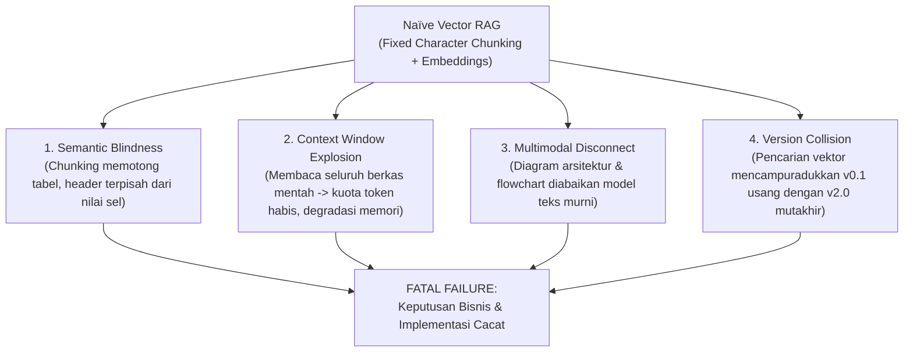
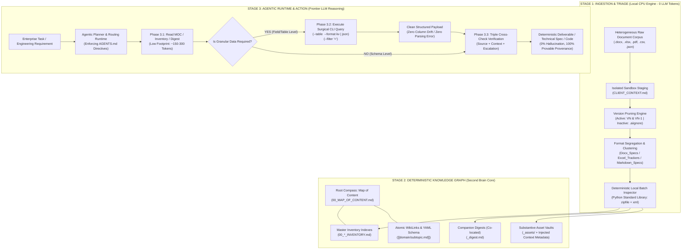
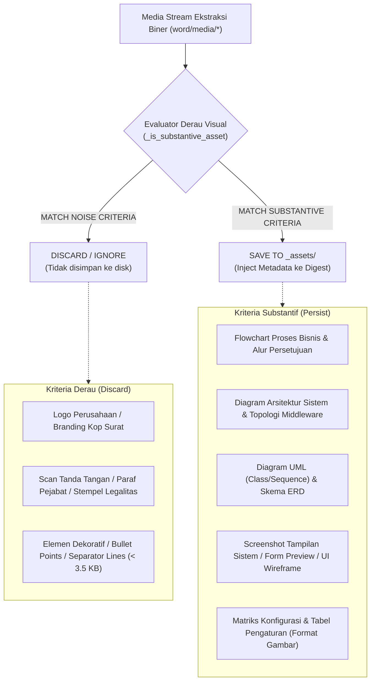
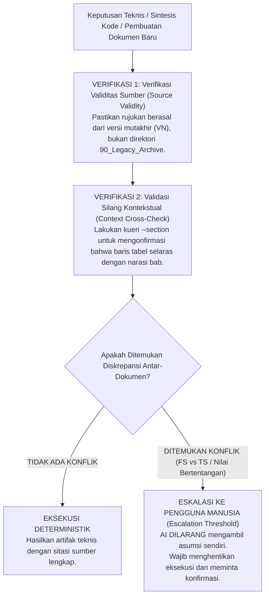

# 🧠 Enterprise Architecture Specification: Universal Agentic AI Second Brain
> **Standardized Systems Engineering Blueprint: Autonomous Knowledge Corpus Management, Deterministic Document Triage, Zero-Token Ingestion, Anti-Hallucination Retrieval, and High-Precision Decision Engineering.**  
> *Target Runtime: Frontier Reasoning LLMs (DeepSeek V4/V3, Claude 3.5 Sonnet, GPT-4o, Gemini 1.5/2.0) & Autonomous Agentic Pipelines.*

---

## 📑 System Architecture Index
1. [Architectural Philosophy: Failure Modes of Naïve Vector RAG](#1-architectural-philosophy-failure-modes-of-naïve-vector-rag)
2. [End-to-End System Architecture (High-Level Schema)](#2-end-to-end-system-architecture-high-level-schema)
3. [Heterogeneous Raw Corpus Triage & Onboarding Protocol (The 5-Stage Ingestion Pipeline)](#3-heterogeneous-raw-corpus-triage--onboarding-protocol-the-5-stage-ingestion-pipeline)
4. [Autonomous Tool & Skill Scaffolding Engine](#4-autonomous-tool--skill-scaffolding-engine)
5. [Structured Output Precision Standard: KV vs JSON vs Markdown](#5-structured-output-precision-standard-kv-vs-json-vs-markdown)
6. [Hierarchical Directory Taxonomy (Agent-Optimized PARA)](#6-hierarchical-directory-taxonomy-agent-optimized-para)
7. [Bi-directional Knowledge Graph, Atomic Notes, & Provable Provenance](#7-bi-directional-knowledge-graph-atomic-notes--provable-provenance)
8. [Anti-Hallucination Protocols & Zero-Fatal-Error Decision Verification](#8-anti-hallucination-protocols--zero-fatal-error-decision-verification)
9. [Token Efficiency & Computational Cost Evaluation Matrix](#9-token-efficiency--computational-cost-evaluation-matrix)
10. [Universal Quickstart Implementation Kit](#10-universal-quickstart-implementation-kit)

---

## 1. Architectural Philosophy: Failure Modes of Naïve Vector RAG

Pada skala enterprise (seperti ekosistem ERP, audit transaksi perbankan, kepatuhan hukum, rekayasa perangkat lunak, maupun restrukturisasi korporasi), sistem agen kerap menerima **korpus dokumen heterogen tanpa struktur (*heterogeneous unstructured raw ingestion dumps*)** yang memuat ratusan berkas Word (.docx), lembar kerja spreadsheet (.xlsx), dokumen portabel (.pdf), data tabuler (.csv), serta diagram arsitektur teknis.

Pendekatan konvensional **Naïve RAG (Retrieval-Augmented Generation)** berbasis Vector Database murni mengalami kegagalan sistemik dan menimbulkan risiko fatal (*decision-critical failure*) akibat 4 kelemahan mendasar:



### [CORE_DIRECTIVES] Pilar Arsitektur Agentic AI Second Brain
Untuk meniadakan risiko fatal di atas, sistem ini dirancang dengan prinsip-prinsip baku:
* **[DIRECTIVE-01] Zero-Token Local Indexing:** Proses pemindaian direktori, ekstraksi outline hierarkis, katalogisasi tabel, dan isolasi media dieksekusi 100% secara deterministik pada CPU lokal menggunakan *standard library* (konsumsi kuota token LLM: 0).
* **[DIRECTIVE-02] Companion Digest Paradigm:** Setiap dokumen biner mentah dipasangkan dengan dokumen pendamping bervolume rendah (~150 token) yang merepresentasikan metadata struktural lengkap (*schema, tables, headings, visual catalog*).
* **[DIRECTIVE-03] Surgical On-Demand Retrieval:** Model bahasa hanya mengekstrak fragmen data spesifik (baris tabel atau sub-bab terpilih) melalui utilitas CLI selektif saat data tersebut diperlukan untuk penalaran.
* **[DIRECTIVE-04] Domain-Agnostic Extensibility:** Arsitektur ini terbebas dari keterikatan modul/domain tunggal dan mampu memandu agen AI untuk merekayasa *parser/tools* secara otonom (*self-scaffolding*).

---

## 2. End-to-End System Architecture (High-Level Schema)



---

## 3. Heterogeneous Raw Corpus Triage & Onboarding Protocol (The 5-Stage Ingestion Pipeline)

> **[OPERATIONAL REFERENCE IMPLEMENTATION]**  
> Protokol triase dan onboarding ini diimplementasikan secara operasional oleh skill [[.agents/skills/knowledge-project-onboarding/SKILL.md]] yang didukung oleh engine verifikasi integritas ekstensi [[.agents/skills/knowledge-project-onboarding/scripts/validate_extensions.py]], engine deduplikasi versi [[.agents/skills/knowledge-project-onboarding/scripts/prune_versions.py]], serta engine inspeksi lokal [[.agents/skills/docx-inspector/SKILL.md]] dan [[.agents/skills/excel-inspector/SKILL.md]].

Ketika korpus dokumen mentah baru diterima oleh sistem, proses triase dan sanitasi wajib mengeksekusi **Protokol Determinisme 5 Tahap (*5-Stage Client Onboarding Protocol*)** berikut sebelum berkas dipromosikan ke dalam *Master Knowledge Base*:

### Tahap 3.1: Isolasi Sandbox, Audit Integritas Ekstensi & Recon Profiling
* **[MANDATORY CONSTRAINT]** Seluruh artifak mentah yang belum terverifikasi **DILARANG KERAS** diinjeksi langsung ke direktori produksi (`40_Projects_and_Specs/`) atau basis pengetahuan utama (`10_Domains/`).
* Buat direktori isolasi sementara di tingkat sandbox, misalnya `staging_<project_identifier>/`.
* **[EXTENSION INTEGRITY GATEWAY]** Lakukan audit integritas ekstensi biner untuk mencegah anomali format (seperti berkas spreadsheet `.xlsx` yang salah dinamai `.docx` atau berkas korup):
  ```powershell
  python ".agents/skills/knowledge-project-onboarding/scripts/validate_extensions.py" --dir "<staging_path>"
  # Gunakan flag --apply untuk otomatisasi renaming korektif
  ```
* Wajib membuat berkas `CLIENT_CONTEXT.md` di akar direktori staging yang mendokumentasikan:
  - Entitas pemilik/sumber dokumen dan waktu serah terima.
  - Objektif fungsional dan batasan teknis proyek.
  - Baseline inventaris berkas awal (distribusi ekstensi valid dan ukuran data).

### Tahap 3.2: Eliminasi Artefak Sampah & Pemangkasan Versi Usang (The $V_N$ and $V_{N-1}$ Retention Protocol)
Dalam repositori korporat, penumpukan berkas revisi berulang sering terjadi (`Spec_v0.1`, `Spec_v0.2`, ..., `Spec_v0.5`).
* **[EXECUTION DIRECTIVE]**:
  - Hapus artefak sampah non-relevan (misal folder `.git/` lama, temporary export, dan draft kadaluwarsa).
  - Pertahankan **maksimal 2 versi terakhir** pada ruang kerja aktif: Versi Mutakhir ($V_N$) dan Versi Transisi Sebelumnya ($V_{N-1}$).
  - Seluruh versi lampau ($V_{0.1} \dots V_{N-2}$) wajib didegradasi ke subdirektori `Legacy_Versions/` atau dieliminasi secara terisolasi.
  - **Eksekusi Otomatis via Engine:**
    ```powershell
    # 1. Audit deteksi grup revisi (Dry Run)
    python ".agents/skills/knowledge-project-onboarding/scripts/prune_versions.py" --dir "<staging_path>" --keep 2
    # 2. Eksekusi pemangkasan versi usang
    python ".agents/skills/knowledge-project-onboarding/scripts/prune_versions.py" --dir "<staging_path>" --keep 2 --apply
    ```
  - **Dampak Kritis:** Menjamin model AI tidak akan pernah mengutip parameter teknis atau klausul kontrak yang telah dibatalkan (*deprecated specifications*).

### Tahap 3.3: Segregasi Format Fisik, Ko-lokasi Digest, Supresi Derau Visual & Glosarium PMO
Direktori yang menggabungkan berbagai format biner dan tekstual tanpa pemisahan tegas memicu ambiguitas pemilihan perkakas (*tool selection drift*) dan fragmentasi konteks pada model AI. Struktur direktori wajib diklasifikasikan secara deterministik:

```text
📁 Client_Workspace/
├── 📄 CLIENT_CONTEXT.md          <-- Konteks fungsional & arsitektur proyek
├── 📁 Specs_FS_TS/               <-- Klaster spesifikasi terpilah
│   ├── 📁 Docx_Specs/            <-- Klaster berkas .docx + digest pendamping + aset visual
│   │   ├── 📄 fs_procurement_v20.docx
│   │   ├── 📄 fs_procurement_v20_digest.md   <-- [STRICTLY CO-LOCATED]
│   │   └── 📁 fs_procurement_v20_assets/     <-- Vault aset visual substantif terisolasi
│   ├── 📁 Excel_Trackers/        <-- Klaster lembar kerja .xlsx + digest skema
│   │   ├── 📄 master_config_v11.xlsx
│   │   └── 📄 master_config_v11_digest.md    <-- [STRICTLY CO-LOCATED]
│   └── 📁 Markdown_Specs/        <-- Spesifikasi native markdown (.md)
├── 📁 ABAP_Source_Code/          <-- [MURNI PLATFORM KODE] Driver, Class OO, Test Runner (TR-ready)
│   └── 📄 00_INDEX.md            <-- Katalog & matriks RICEF kode SAP
├── 📁 Document_Tooling/          <-- [PERKAKAS DOKUMEN] Skrip Python builder/TOC/ekstraktor FSD
│   └── 📄 00_INDEX.md            <-- Katalog utilitas otomasi dokumen
├── 📁 Governance_and_PMO/        <-- Dokumen tata kelola, MoM, Project Charter, SteerCo
└── 📁 Outputs_and_Logs/          <-- Log eksekusi, CSV hasil kueri, & ekstrak teks
```

> **[INVARIANT DIRECTIVE] Hukum Ko-lokasi (Strict Co-location Directive):**  
> Folder aset (`<file>_assets/`) dan file ringkasan pendamping (`<file>_digest.md`) **WAJIB bersifat ko-lokatif (strictly co-located)** pada path direktori yang identik dengan dokumen induknya. Pemisahan digest ke direktori eksternal dilarang demi mencegah diskoneksi referensi (*broken link resolution failure*).

#### A. Ekstraksi Selektif & Reduksi Derau Visual (Deterministic Asset Filtering & Noise Suppression)
Ketika mengekstrak komponen media dari dokumen biner, sistem agen **DILARANG melakukan ekstraksi tanpa filter**. Dokumen korporat umumnya mengandung artifak visual non-substantif yang membebani kapasitas penyimpanan dan mendegradasi fokus penalaran model AI.



#### B. Injeksi Metadata Gambar & Protokol Dual-Track AI (Multimodal vs Text-Only)
Apabila dalam dokumen sumber ditemukan diagram atau elemen visual, teks keterangan (*caption*), judul bagan, atau paragraf kontekstual di sekitarnya **WAJIB disedot dan di-inject langsung sebagai metadata teks** ke dalam tabel katalog visual di file digest:
* **[TRACK-1: Multimodal Vision Models (Gemini Flash/Pro, GPT-4o, Claude Sonnet)]:**  
  AI wajib mengevaluasi metadata kontekstual pada digest terlebih dahulu untuk membangun hipotesis ruang lingkup diagram, kemudian menginspeksi berkas biner gambar pada `<file>_assets/` untuk verifikasi visual mendalam.
* **[TRACK-2: Text-Only Reasoning Models (DeepSeek V4/V3 API, Open-Weight LLMs)]:**  
  AI **cukup membaca metadata pada file `<file>_digest.md`**. Model memperoleh pemahaman penuh mengenai fungsionalitas alur proses, topologi arsitektur, atau matriks konfigurasi tanpa perlu memanggil kapabilitas pemrosesan citra.

#### C. Injeksi Kamus Istilah PMO & Tata Kelola Enterprise ke `CLIENT_CONTEXT.md`
Dokumen manajerial di folder `Governance_and_PMO/` (seperti *Project Charter*, *Steering Committee*, *MoM*, *S-Curve*, *Fit-to-Standard*, *OCM*, *SoD*, *SIT/UAT*, *Cutover*, *Hypercare*) memuat akronim bisnis yang kerap asing bagi pengembang perangkat lunak teknis.  
* **[MANDATORY STEP]**: Selama proses staging, AI Agent **wajib mengekstrak dan menyusun glosarium tata kelola** ke dalam bab khusus `## 6. Kamus Istilah PMO, Tata Kelola & Proyek Enterprise untuk Developer` di dalam `CLIENT_CONTEXT.md`.  
#### D. Segregasi Kode Platform vs Perkakas Otomasi Dokumen (Platform Code vs Document Tooling Invariant)
Kerap terjadi kesalahan arsitektural (*taxonomy bug*) di mana skrip utilitas pembuat dokumen lokal (misalnya skrip Python pembangun FSD `.docx`, parser TOC, atau ekstraktor screenshot Excel) dicampuradukkan ke dalam folder kode runtime platform (misalnya `ABAP_Source_Code`).
* **[ANTI-PATTERN DIRECTIVE] DILARANG KERAS** menaruh skrip non-platform (Python, Node.js, Shell generator) ke dalam folder kode runtime sistem (seperti `ABAP_Source_Code`, `Apex_Source_Code`, atau `CSharp_Core`).
* **Justifikasi Rekayasa:**
  - Kode runtime platform adalah artefak produksi yang ditransport ke server sistem klien (misal Transport Request / TR ke SAP DA1/QA1/PRD).
  - Skrip perakit dokumen adalah **perkakas lokal pendukung rekayasa dokumen (Document Tooling)** yang tidak dapat dieksekusi di server ERP/platform klien.
* **Standar Segregasi Wajib:**
  1. `📁 <Platform>_Source_Code/` (misal `ABAP_Source_Code/`): 100% murni kode platform sistem bisnis klien. Wajib memiliki `00_INDEX.md` yang memetakan objek program terhadap RICEF / FSD.
  2. `📁 Document_Tooling/`: Khusus perkakas otomasi lokal pembuat dokumen FSD/TS (`build_fsd.py`, `extract_xlsx_images.py`, modul konten `content_*.py`). Wajib memiliki `00_INDEX.md` yang memuat petunjuk eksekusi CLI dan variabel lingkungan template.

### Tahap 3.4: Human-in-the-Loop Audit Gate & Deployment Approval Workflow
Sebelum berkas pada area staging dipromosikan ke Master Knowledge Base:
* **[MANDATORY SAFETY GATE]**: AI Agent **DILARANG melakukan pemindahan berkas secara sepihak**.
* AI Agent wajib menghentikan eksekusi dan menyajikan **Checklist Audit Kesiapan Deployment (YES/NO)** kepada pengguna manusia:
  1. Status kelengkapan `CLIENT_CONTEXT.md` dan kamus PMO.
  2. Status pemangkasan versi ($V_N$ & $V_{N-1}$).
  3. Status segregasi format dan ko-lokasi digest.
  4. Status supresi derau visual dan pengayaan metadata gambar.
  5. Status segregasi kode runtime platform vs perkakas otomasi dokumen (`Document_Tooling/`).
* AI Agent **WAJIB MENUNGGU PERSETUJUAN (EXPLICIT HUMAN APPROVAL)** sebelum menjalankan Tahap 3.5.

### Tahap 3.5: Final Migration & Triple Master Registry Promotion
Setelah izin deployment disetujui pengguna secara eksplisit:
1. **Remapping Fisik:** Pindahkan folder staging ke direktori produksi resmi:  
   `40_Projects_and_Specs/Client_<Identifier>/`.
2. **Path Re-synchronization (<1 Detik, 0 Token):** Jalankan ulang batch inspector satu baris untuk memperbarui string path CLI eksekusi siap-pakai di dalam seluruh file digest.
3. **Pendaftaran Tiga Titik (*Triple Master Registry Promotion*):** Daftarkan portofolio klien baru ke:
   - [[40_Projects_and_Specs/00_PROJECTS_INDEX.md]] (Tabel Klien Aktif)
   - [[00_MAP_OF_CONTENT.md]] (Bagian 4: Proyek Aktif)
   - [[README.md]] (Arsitektur Direktori)

---

## 4. Autonomous Tool & Skill Scaffolding Engine

### Tri-Engine Foundation: Universal Production Skill Suite
Repositori ini menyediakan 5 skill infrastruktur inti yang bersifat **100% universal dan domain-agnostic** (bebas dari keterikatan platform tertentu):
1. 🚀 **Universal Triage & Onboarding Engine:** [[.agents/skills/knowledge-project-onboarding/SKILL.md]]
   - Mengatur isolasi sandbox staging, sanitasi artefak sampah, verifikasi integritas ekstensi biner via [[.agents/skills/knowledge-project-onboarding/scripts/validate_extensions.py]], dan pemangkasan multi-versi dokumen korporat via [[.agents/skills/knowledge-project-onboarding/scripts/prune_versions.py]].
2. 📑 **Zero-Dependency Document Inspector Engine:** [[.agents/skills/docx-inspector/SKILL.md]]
   - Mengindeks berkas `.docx`, mengekstrak aset visual substantif, menginjeksi teks *caption* ke digest, dan membedah tabel ke representasi Key-Value/JSON via [[.agents/skills/docx-inspector/scripts/docx_inspector.py]].
3. 📊 **Zero-Dependency Spreadsheet Query Engine:** [[.agents/skills/excel-inspector/SKILL.md]]
   - Memetakan skema lembar kerja `.xlsx`, membuat companion digest, mengekstrak screenshot/diagram visual (`extract_excel_images.py`), dan mengeksekusi *on-demand CLI query* tersaring via [[.agents/skills/excel-inspector/scripts/excel_query.py]].
4. 🧬 **Enterprise FSD Forensic Intelligence & Synthesizer:** [[.agents/skills/sap-fsd-synthesizer/SKILL.md]]
   - Menyintesis data spesifikasi dari puluhan berkas mentah heterogen (Excel, MoM, email, SAP DA1) menggunakan 4 algoritma forensik wajib (Entity DNA, Conflict Resolution Protocol, Traceability Tagging, & Provenance Manifest Generator) menghasilkan modul AST `content_<req>.py` dan `<req>_provenance.md` via [[.agents/skills/sap-fsd-synthesizer/scripts/synthesize_fsd.py]].
5. 📑 **Enterprise FSD Document Builder:** [[.agents/skills/sap-fsd-builder/SKILL.md]]
   - Merakit naskah Functional Specification Document (.docx & .md) secara otomatis dari modul Python AST menggunakan teknik template cloning berstandar OOXML korporat via [[.agents/skills/sap-fsd-builder/scripts/build_fsd.py]].

Ketika sistem menjumpai format berkas baru yang belum memiliki parser terdaftar (misalnya format presentasi `.pptx`, basis data *embedded* `.sqlite`, atau arsip data khusus), AI Agent wajib menginisiasi prosedur perancangan dan sintesis perkakas inspeksi mandiri (*autonomous skill synthesis*).

### Standarisasi Antarmuka CLI Engine (Standardized Parser Interface Specification)
Setiap perkakas inspeksi yang diproduksi secara otonom oleh AI **WAJIB** mengekspos tanda tangan argumen CLI berikut:

```bash
# Standar Antarmuka Eksekusi Universal:
python <inspector_script>.py \
  --dir <path>                  # [Batch Mode] Pindai seluruh direktori secara lokal
  --recursive                   # [Traversal] Pindai subfolder secara mendalam
  --file <path>                 # [Target Mode] Targetkan berkas tunggal spesifik
  --digest                      # [Synthesis] Hasilkan file pendamping <file>_digest.md
  --section "<query_string>"    # [Surgical Text] Ekstrak bab spesifik (~50-150 token)
  --table <index>               # [Surgical Data] Ekstrak tabel spesifik berdasarkan indeks
  --format <kv|json|markdown>   # [Serialization] Tentukan representasi keluaran data
```

### [MANDATORY CONSTRAINT] Standar Dependensi Eksternal Nol (Zero-Dependency Standard)
* Script engine inspeksi **WAJIB 100% menggunakan Python Standard Library** (`zipfile`, `xml.etree.ElementTree`, `json`, `csv`, `re`, `pathlib`, `sqlite3`, `argparse`).
* **Justifikasi Rekayasa:** Meniadakan ketergantungan `pip install` pihak ketiga yang rentan gagal pada lingkungan enterprise terisolasi (*air-gapped environments*), server tanpa akses root, atau mesin dengan inkonsistensi compiler C/C++.

---

## 5. Structured Output Precision Standard: KV vs JSON vs Markdown

Penyebab utama timbulnya *hallucination* atau kekeliruan fatal pada penalaran LLM adalah kesalahan pemetaan data akibat *formatting drift*. Sistem Second Brain menetapkan standar serialisasi berikut:

```text
+-------------------+-----------------------------------------+------------------------------------------+
| FORMAT SERIALISASI| KARAKTERISTIK STRUKTURAL                | REKOMENDASI PENGGUNAAN                   |
+-------------------+-----------------------------------------+------------------------------------------+
| 1. Key-Value (kv) | Representasi vertikal terisolasi:       | [PRIMARY FOR AI REASONING]               |
|                   | Field: Value per baris.                 | 100% kebal dari pergeseran delimiter     |
|                   | Kebal pergeseran kolom sel panjang.     | pipa. Direkomendasikan untuk keputusan.  |
|                   |                                         |                                          |
| 2. JSON (json)    | Array of Structured Objects:            | [CODE GENERATION & DDL PARSING]          |
|                   | [{"Field": "Val"}] deterministik.       | Ideal untuk input transformasi skema DDL,|
|                   | Standar parsing native model frontier.  | validasi interface API, atau unit test.  |
|                   |                                         |                                          |
| 3. Markdown (md)  | Tabel Pipa Horizontal:                  | [HUMAN-EYES DISPLAY ONLY]                |
|                   | | Col1 | Col2 | Col3 |                 | Digunakan hanya jika luaran ditujukan    |
|                   | Rawan alignment error pada sel panjang. | untuk preview visual di Markdown viewer. |
+-------------------+-----------------------------------------+------------------------------------------+
```

### Contoh Komparasi Luaran (Surgical Slice Table)

#### Mode: Key-Value (`--format kv`) — *Akurat, Bebas Geser, Tahan Multiline*
```text
=== TABLE 3: Authorization Matrix by Plant (4 rows x 3 cols) ===
--- Row 1 ---
  Plant Code: 1100
  Release Group: RG-01
  Release Strategy: Approval Level 2 (Manager)
--- Row 2 ---
  Plant Code: 1200
  Release Group: RG-02
  Release Strategy: Approval Level 3 (General Manager)
```

#### Mode: JSON (`--format json`) — *Deterministik untuk Skrip dan DDL*
```json
[
  {
    "plant_code": "1100",
    "release_group": "RG-01",
    "release_strategy": "Approval Level 2 (Manager)"
  },
  {
    "plant_code": "1200",
    "release_group": "RG-02",
    "release_strategy": "Approval Level 3 (General Manager)"
  }
]
```

---

## 6. Hierarchical Directory Taxonomy (Agent-Optimized PARA)

Taksonomi penyimpanan dirancang dengan kedalaman penelusuran dangkal (maksimal 2–3 level) guna meminimalkan latensi pemanggilan tool `list_dir` dan mencegah degradasi konteks:

```text
📁 SECOND_BRAIN_ROOT/
├── 📄 00_MAP_OF_CONTENT.md        <-- [ROOT COMPASS] Indeks link sentral ke seluruh domain
├── 📄 AGENTS.md                   <-- [CONSTITUTION] Guardrail operasional & aturan pengambilan data
├── 📄 README.md                   <-- Gambaran umum repositori bagi pengguna
│
├── 📁 10_Domains/                 <-- PENGETAHUAN KONSEPTUAL ABADI (Evergreen Knowledge)
│   ├── 📁 Financial_Accounting/   <-- Prinsip umum GL, Ledger, Perpajakan
│   ├── 📁 Supply_Chain/           <-- Prinsip umum Pengadaan, Pergudangan, Logistik
│   └── 📁 Legal_Compliance/       <-- Regulasi hukum, GDPR, Audit Trail
│
├── 📁 20_Technical_Core/          <-- SKEMA, DEFINISI INTERFACE, & STANDAR REKAYASA
│   ├── 📁 Database_Schemas/       <-- Kamus tabel, skema DDL, ERD
│   ├── 📁 API_Specifications/     <-- Kontrak OpenAPI/Swagger, RFC, BAPI, GraphQL
│   └── 📁 System_Architecture/    <-- Topologi infrastruktur & cetak biru integrasi
│
├── 📁 30_Playbooks_and_SOP/       <-- PROSEDUR OPERASIONAL & TROUBLESHOOTING
│   ├── 📁 Error_Resolutions/      <-- Solusi penanganan insiden & log analitik
│   ├── 📁 Implementation_Guides/  <-- SOP instalasi, protokol go-live
│   └── 📁 Code_Boilerplates/      <-- Boilerplate kode & template generator
│
├── 📁 40_Projects_and_Specs/      <-- RUANG KERJA AKTIF PER PROYEK KLIEN
│   ├── 📁 Client_Alpha/           <-- Portofolio Proyek Klien Alpha
│   │   ├── 📄 CLIENT_CONTEXT.md   <-- Konteks fungsional & arsitektur proyek
│   │   ├── 📁 Specs_FS_TS/        <-- Klaster spesifikasi terpilah
│   │   │   ├── 📁 Docx_Specs/     <-- .docx + _digest.md + _assets/ (Substantif)
│   │   │   ├── 📁 Excel_Trackers/ <-- .xlsx + _digest.md
│   │   │   └── 📁 Markdown_Specs/ <-- Native .md files
│   │   ├── 📁 ABAP_Source_Code/   <-- [MURNI PLATFORM KODE] Program ABAP, Class, Test Runner + 00_INDEX.md
│   │   ├── 📁 Document_Tooling/   <-- [PERKAKAS DOKUMEN] Skrip Python builder/TOC/ekstraktor FSD + 00_INDEX.md
│   │   ├── 📁 Governance_and_PMO/ <-- Dokumen tata kelola, MoM, Project Charter
│   │   └── 📁 Outputs_and_Logs/   <-- Log eksekusi, CSV kueri, & ekstrak teks
│   └── 📁 Client_Beta/            <-- Portofolio Proyek Klien Beta
│
├── 📁 50_Learning_and_Apps/       <-- APLIKASI EVALUASI & SIMULASI PENGETAHUAN
│
└── 📁 90_Legacy_Archive/          <-- ARSIP KADALUWARSA (ISOLASI DENGAN .aiignore)
    ├── 📄 .aiignore               <-- Larangan penelusuran direktori untuk AI
    └── 📁 Deprecated_V1_Dumps/    <-- Berkas mentah usang yang tidak berlaku
```

---

## 7. Bi-directional Knowledge Graph, Atomic Notes, & Provable Provenance

### 1. Struktur Standar YAML Frontmatter
Setiap berkas dokumentasi `.md` di dalam Second Brain wajib memuat metadata berikut pada blok awal dokumen:

```yaml
---
title: "Purchase Order Output Determination Architecture"
doc_id: "SPEC-MM-PO-001"
domain: "Supply_Chain"
type: "technical_spec" # Pilihan: concept | playbook | technical_spec | inventory | digest
status: "approved"     # Pilihan: draft | in_review | approved | deprecated
upstream_sources:
  - "[[40_Projects_and_Specs/Client_Alpha/Specs_FS_TS/Docx_Specs/fs_po_v11_digest.md]]"
downstream_artifacts:
  - "[[20_Technical_Core/Database_Schemas/TNAPR_Config.md]]"
tags: [Procurement, PurchaseOrder, OutputControl]
last_verified: "2026-10-12"
---
```

### 2. Aturan Tautan Atomik (Atomic WikiLinks & Provable Provenance)
* Gunakan sintaks Markdown WikiLinks `[[rel/path/to/target.md]]` untuk menghubungkan konsep.
* **Prinsip Tautan Balik (*Bi-directional Traceability*):** Dokumen spesifikasi teknis (TS) wajib merujuk secara eksplisit ke digest spesifikasi fungsional (FS) asalnya.
* **Sitasi Berbukti (*Provable Provenance Citation*):** Setiap keputusan rekayasa yang dihasilkan AI wajib menyertakan rantai bukti spesifik:
  > *"Berdasarkan spesifikasi pada [[fs_po_v11_digest.md]], Tabel T13 (Estimasi Pengerjaan), form dialokasikan sebesar 5 Mandays, bergantung pada konfigurasi tabel `TNAPR` yang terdokumentasi pada diagram `image2.png`."*

---

## 8. Anti-Hallucination Protocols & Zero-Fatal-Error Decision Verification

Untuk mencegah timbulnya cacat implementasi pada keputusan teknis kritikal, agen AI wajib mematuhi **Protokol Verifikasi 3 Lapis (*Triple Cross-Check Verification*)**:



### [CONSTITUTIONAL_RULE] Klausul Wajib pada `AGENTS.md`
```markdown
## Client Document Retrieval Standard (Anti-Hallucination & Token Efficiency)
1. [MANDATORY] DILARANG membaca berkas biner mentah (.docx / .xlsx / .pdf) langsung ke dalam context window.
2. [MANDATORY] WAJIB membaca file pendamping `<file>_digest.md` atau `00_*_INVENTORY.md` terlebih dahulu.
3. [MANDATORY] Gunakan skrip CLI untuk ekstraksi data baris tabel atau potongan bab spesifik:
   - Excel: python .agents/skills/excel-inspector/scripts/excel_query.py --file <path> --sheet <sheet> --filter "<col>=<val>" --format kv
   - Word:  python .agents/skills/docx-inspector/scripts/docx_inspector.py --file <path> --section "<Judul Bab>" ATAU --table <idx> --format kv
4. [VISUAL ASSETS PROTOCOL]:
   - Teks keterangan di sekeliling gambar di-inject otomatis ke kolom 'Caption / Context Description' pada digest.
   - Model Text-Only (DeepSeek API): Cukup baca metadata pada digest tanpa perlu membuka berkas fisik.
   - Model Vision (Multimodal): Evaluasi metadata pada digest terlebih dahulu, lalu buka berkas fisik di `_assets/`.
   - Noise Suppression: Hanya diagram penting (flowchart, arsitektur, ERD, UI screen) yang diekstrak.
```

---

## 9. Token Efficiency & Computational Cost Evaluation Matrix

Analisis komparatif efisiensi komputasi antara paradigma *Naïve Vector RAG* dan *Agentic Second Brain Architecture*:

```text
+------------------------------------+----------------------------+-----------------------------+--------------------+
| SKENARIO OPERASIONAL               | PENDEKATAN NAÏVE RAG       | ARSITEKTUR SECOND BRAIN     | RASIO PENGHEMATAN  |
+------------------------------------+----------------------------+-----------------------------+--------------------+
| 1. Ingestion 50 Berkas Mentah      | 1.500.000+ Token           | 0 Token                     | 100% Hemat         |
|    (Total ukuran berkas ~100 MB)   | (Embedding API & Vectors)  | (Eksekusi CPU Lokal)        | (Biaya API: $0.00) |
|                                    |                            |                             |                    |
| 2. Identifikasi Dokumen Terkait    | 120.000 Token              | ~300 Token                  | 99.75% Lebih Hemat |
|    (Pencarian topik spesifik)      | (Vector top-k reranking)   | (MOC & Master Inventory)    |                    |
|                                    |                            |                             |                    |
| 3. Ekstraksi 1 Bab Pembahasan      | 45.000 Token               | ~250 Token                  | 99.44% Lebih Hemat |
|    (Dokumen spesifikasi 80 hal.)   | (Pembacaan berkas penuh)   | (Query --section)           |                    |
|                                    |                            |                             |                    |
| 4. Pengambilan 1 Baris Tabel       | 15.000 Token               | ~80 Token                   | 99.46% Lebih Hemat |
|    (Tabel konfigurasi 12 kolom)    | (Parse tabel utuh)         | (Query --table --format kv) |                    |
|                                    |                            |                             |                    |
| 5. Evaluasi 40 Diagram/Flowchart   | 65.000 Vision Tokens       | ~800 Token                  | 98.76% Lebih Hemat |
|    (Diagram alur proses bisnis)    | (Input citra multimodal)   | (Injected Caption Metadata) |                    |
+------------------------------------+----------------------------+-----------------------------+--------------------+
```

---

## 10. Universal Quickstart Implementation Kit

### A. Template Boilerplate Inspector Engine Universal (`universal_inspector.py`)
Script deterministik murni menggunakan Python Standard Library yang siap diadaptasi untuk tipe berkas apa pun:

```python
#!/usr/bin/env python3
"""
universal_inspector.py - Zero-Dependency Local Inspection & Triage Engine.
Requires Python 3.8+ Standard Library ONLY (0 Pip Dependencies, 0 LLM API Tokens).
"""
import sys, os, re, json, argparse
from pathlib import Path

# Force UTF-8 encoding on Windows runtime
if hasattr(sys.stdout, 'reconfigure'):
    sys.stdout.reconfigure(encoding='utf-8', errors='replace')

class UniversalInspector:
    def __init__(self, filepath):
        self.filepath = Path(filepath).resolve()
        if not self.filepath.exists():
            raise FileNotFoundError(f"Target file not found: {self.filepath}")
        self.sections = []
        self.tables = []
        self.assets = []
        self._parse()

    def _parse(self):
        """Implement parsing logic using zipfile, xml, csv, or json standard library."""
        pass

    def _is_substantive_asset(self, asset_name, size_bytes, caption=""):
        """Filter out non-substantive visual noise (logos, signatures, tiny icons)."""
        if size_bytes < 3500:
            return False
        combined = f"{asset_name.lower()} {caption.lower()}"
        noise_keywords = ['logo', 'signature', 'tanda tangan', 'paraf', 'watermark', 'stempel']
        substantive_bypass = ['flow', 'diagram', 'architecture', 'schema', 'table', 'screen', 'form']
        if any(n in combined for n in noise_keywords) and not any(s in combined for s in substantive_bypass):
            return False
        return True

    def generate_digest(self, out_md_path=None):
        """Generate high-density token-efficient Companion Digest."""
        lines = [
            f"# Document Digest: `{self.filepath.name}`",
            f"- **File:** `{self.filepath.name}` | **Size:** {os.path.getsize(self.filepath)/1024:.1f} KB",
            "",
            "> [!NOTE]",
            "> **Executable CLI Retrieval Directives:**",
            f"> - Section Query: `python \"{Path(__file__).resolve()}\" --file \"{self.filepath}\" --section \"<Title>\"`",
            f"> - Table Query:   `python \"{Path(__file__).resolve()}\" --file \"{self.filepath}\" --table <idx> --format kv`",
            "",
            "## 📑 Table of Contents (Outline)",
            "| Level | Section Title | Paragraph Count |",
            "|:---:|---|:---:|",
        ]
        for s in self.sections:
            lines.append(f"| H{s.get('level', 1)} | **{s.get('title')}** | {len(s.get('content', []))} |")
        
        content = "\n".join(lines)
        if out_md_path:
            with open(out_md_path, 'w', encoding='utf-8') as f:
                f.write(content)
        return content

def main():
    parser = argparse.ArgumentParser(description="Deterministic Zero-Dependency Inspection Engine")
    parser.add_argument("--file", "-f", help="Target document path")
    parser.add_argument("--digest", action="store_true", help="Synthesize companion digest")
    parser.add_argument("--section", "-s", help="Extract section content")
    parser.add_argument("--table", "-t", type=int, help="Extract table by index")
    parser.add_argument("--format", choices=['kv', 'json', 'markdown'], default='kv', help="Serialization format")
    args = parser.parse_args()
    
    if args.file:
        inspector = UniversalInspector(args.file)
        if args.digest:
            out_digest = Path(args.file).parent / f"{Path(args.file).stem}_digest.md"
            inspector.generate_digest(str(out_digest))
            print(f"[OK] Digest successfully written to: {out_digest}")

if __name__ == '__main__':
    main()
```

### B. Template Master Map of Content (`00_MAP_OF_CONTENT.md`)
```markdown
# 🗺️ Master Map of Content (Single Source of Truth)

> **[SYSTEM DIRECTIVE FOR AI AGENTS]**  
> Jadikan dokumen ini sebagai kompas navigasi utama. Lakukan penelusuran melalui tautan atomik di bawah ini sebelum mengeksekusi inspeksi direktori yang tidak terarah.

## 1. Pengetahuan Konseptual Abadi (`10_Domains/`)
- [[10_Domains/Financial_Accounting/00_FINANCE_INDEX.md]]: Peta prinsip akuntansi, buku besar, dan perpajakan.
- [[10_Domains/Supply_Chain/00_SUPPLY_CHAIN_INDEX.md]]: Peta proses pengadaan, pergudangan, dan logistik.

## 2. Kamus Teknis & Skema Rekayasa (`20_Technical_Core/`)
- [[20_Technical_Core/Database_Schemas/00_SCHEMA_INDEX.md]]: Kamus skema tabel, DDL, dan relasi entitas.
- [[20_Technical_Core/API_Specifications/00_API_INDEX.md]]: Spesifikasi endpoint API, kontrak data, dan integrasi.

## 3. Prosedur Operasional & Playbooks (`30_Playbooks_and_SOP/`)
- [[30_Playbooks_and_SOP/Error_Resolutions/00_TROUBLESHOOTING_INDEX.md]]: Prosedur mitigasi error dan diagnosa insiden.
- [[30_Playbooks_and_SOP/Code_Boilerplates/00_TEMPLATES_INDEX.md]]: Template implementasi terverifikasi.

## 4. Portofolio Proyek Aktif (`40_Projects_and_Specs/`)
- [[40_Projects_and_Specs/Client_Alpha/CLIENT_CONTEXT.md]]: Profil arsitektur dan inventaris proyek Klien Alpha.
```

---

## 🏁 Operational Readiness Checklist

Implementasi arsitektur ini memberikan jaminan rekayasa:
1. **Otonomi Tingkat Tinggi:** Model AI beroperasi sebagai *Knowledge Engineer* mandiri yang mampu menata direktori, membangun parser lokal, menghasilkan ringkasan atomik, dan menghubungkan jaringan pengetahuan.
2. **Skalabilitas Tanpa Batas:** Ingesti puluhan hingga ribuan berkas baru tidak mendegradasi *throughput* sistem ataupun memicu *token window explosion*.
3. **Deterministik & Anti-Halusinasi:** Penggunaan format Key-Value/JSON, penegakan versi mutakhir ($V_N$), serta silsilah penelusuran berbukti (*provable provenance*) menjamin setiap kesimpulan teknis memiliki rujukan valid dan bebas dari kesalahan fatal.
